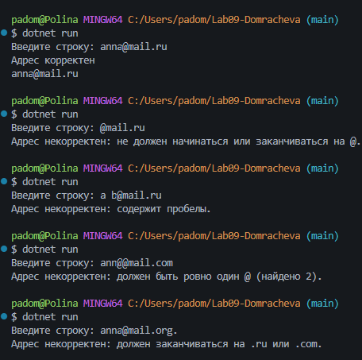
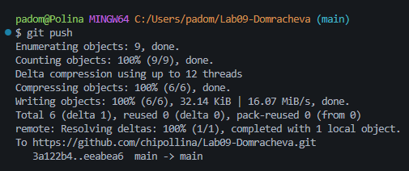

# Практическая работа №9 
**ФИО: Домрачевой Полина**   

**Группа: ИСП-241**   

**Дата: 23.10.2026** 

## Что изучено 
- Как работать со строкой как с набором символов: длина, индекс, перебор через `foreach`.
- Что строки в C# неизменяемы: методы возвращают новую строку, поэтому результат нужно сохранять в переменную. Чтобы много раз дописывать строку в цикле, лучше брать `StringBuilder` с `Append` — он не создаёт новую строку на каждом шаге, а работает с одним буфером.
- Как проверять содержимое (`Contains`, `StartsWith`, `EndsWith`) и вырезать часть строки через `Substring(начало, длина)`.

## Скриншоты 

